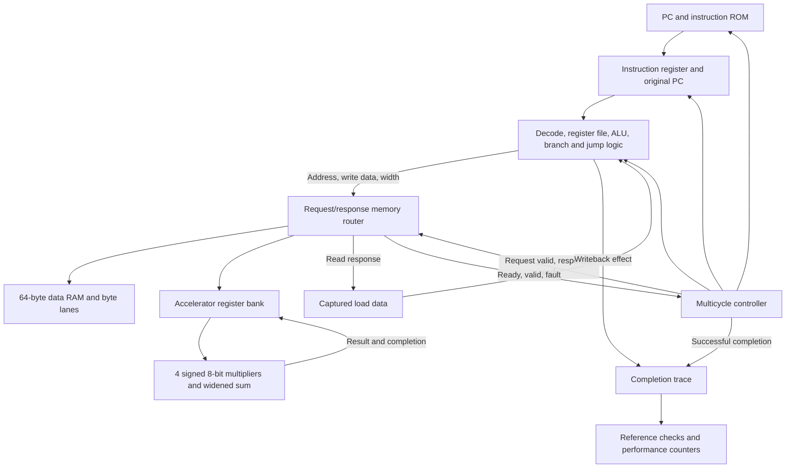

# RV32 Dot-Product SoC

A from-scratch **SystemVerilog multicycle RISC-V teaching processor** with a **memory-mapped signed dot-product accelerator**, self-checking verification, and a **Spartan-7 FPGA implementation**.

The CPU executes programs from ROM and controls the accelerator using ordinary loads and stores. This project covers RTL design, instruction-level checking, software/hardware benchmarking, and FPGA synthesis, placement and routing.

**Status:** simulated and implemented at **50 MHz** on `xc7s50csga324-1`; routed timing passed and a bitstream was generated. **Physical board validation is pending.**

## Key results

| Result | Measurement |
| --- | --- |
| Example end-to-end acceleration | **7.698×**, 816 software cycles vs. 106 accelerator-program cycles |
| Paired benchmark verification | 73 vector pairs × 3 memory latencies = 219 comparisons / 438 program executions |
| Routed FPGA resources | 1,791 LUTs, 1,502 flip-flops; 0 DSPs and 0 block RAMs |
| Routed timing at 50 MHz | Setup slack **+2.244 ns**, hold slack **+0.142 ns** |
| Final implementation DRC | 0 violations |

Speedup is an equal-clock **simulation cycle comparison** against a straightforward RV32I shift/add baseline, including setup, memory transfers, polling and result readback. It is not a measured board speedup. See [benchmark methodology and results](docs/BENCHMARK.md).

## Architecture



The main CPU/accelerator top is [`soc_top`](rtl/soc_top.sv). The physical FPGA top is [`boolean_board_top`](rtl/boolean_board_top.sv), which adds clock generation, reset synchronization and result/status LEDs.

- **CPU:** 32-bit multicycle execution, 32 registers with hardwired-zero `x0`, separate instruction ROM and data RAM.
- **Controller:** fetch → decode → execute; memory instructions add request/wait and, for loads, writeback states. This CPU is not pipelined.
- **Data interface:** one outstanding request, configurable response latency, and stable held responses. Stalls do not repeat stores or accelerator starts.
- **Accelerator:** four signed 8×8-bit products, widened addition and a 32-bit result. Accessed through ordinary `LW`/`SW`; no custom opcode.
- **Verification:** completion traces, independent Python instruction predictions, self-checking tests and cycle/retirement/memory-wait counters. Performance counters are instantiated beside the CPU in testbenches.

See [architecture and module map](docs/ARCHITECTURE.md) for interfaces and sequencing.

## Implemented instruction set

| Group | Instructions |
| --- | --- |
| Register arithmetic/logic | `ADD SUB AND OR XOR SLL SRL SRA SLT SLTU` |
| Immediate arithmetic/logic | `ADDI ANDI ORI XORI SLLI SRLI SRAI SLTI SLTIU` |
| Memory | `LB LBU LH LHU LW SB SH SW` |
| Conditional branches | `BEQ BNE BLT BGE BLTU BGEU` |
| Jumps / upper immediates | `JAL JALR LUI AUIPC` |

This is an **RV32I-based educational implementation**, without a claim of full ISA compliance. There is no CPU M extension, CSR/interrupt subsystem, architectural trap handler, cache or OS support. Unsupported operations and invalid accesses enter a stopping fault state until reset. Demo programs intentionally reach an invalid fetch after their final instruction; this is not a HALT instruction.

## Accelerator programming

| Data address / offset | Purpose |
| --- | --- |
| `0x00000000–0x0000003F` | 64-byte, little-endian data RAM |
| `0x10000000 + 0x00` | Operand A: packed four signed bytes |
| `0x10000000 + 0x04` | Operand B: packed four signed bytes |
| `0x10000000 + 0x08` | CONTROL: write bit 0 = 1 to start; other bits must be zero |
| `0x10000000 + 0x0C` | STATUS: read-only bit 0 = busy, bit 1 = done |
| `0x10000000 + 0x10` | RESULT: read-only 32-bit signed sum |

Software writes operands while idle, writes START, polls done, then reads RESULT. Accelerator accesses must be aligned 32-bit operations. Reserved offsets, unmapped addresses, invalid accesses and busy operand/restart writes fault. See [register semantics](docs/ARCHITECTURE.md#accelerator-registers).

Example, with lane 0 in bits `[7:0]`:

```text
A = 0x0403FE01 -> [1, -2,  3, 4]
B = 0x08F90605 -> [5,  6, -7, 8]
Dot product = 1*5 + (-2)*6 + 3*(-7) + 4*8 = 4
```

## Run the verification

**Tools used:** Vivado 2025.2 and Python 3.10+. Install Vivado with Spartan-7 support for FPGA builds. No external Python packages are needed.

The commands below work from the repository root. Vivado tools are discovered from the command path or `XILINX_VIVADO`; alternatively pass `--vivado-bin` with your installation's `bin` directory. No fixed drive path is required by the source files.

```powershell
# CPU/accelerator integration, paired benchmark and demo-wrapper tests
python scripts/run_tests.py

# All 25 self-checking testbench tops, including the vendor MMCM simulation
python scripts/run_tests.py --suite full

# Independent Python instruction-model comparison against the current SoC
python verification/run_reference.py

# One testbench, or list the available tests
python scripts/run_tests.py --top tb_soc_top
python scripts/run_tests.py --list
```

Example tool-location override:

```powershell
python scripts/run_tests.py --vivado-bin "C:/AMDDesignTools/2025.2/Vivado/bin"
```

The runner uses the repository as its simulation working directory so ROM/vector paths resolve correctly. Logs and the machine-readable summary go in `build/simulation/`; simulator caches and temporary CSVs are ignored by Git. A test must report `PASS` and have no fatal/error message: an xsim exit code alone is insufficient.

The Python checker covers RAM-based instruction programs at memory latencies 1/2/4 and deliberately corrupts a trace to check that comparison detects a mismatch. Accelerator benchmark expectations use a separate functional oracle for its fixed program, not a general concurrent MMIO ISA simulator.

For manual Vivado use, add `rtl/*.sv` as design sources and select the desired `tb/*.sv` simulation top. Relative ROM/vector paths require simulation from the repository root; the supplied runner handles this automatically. `tb_cpu_reference.sv` is a capture helper driven by the Python runner rather than a standalone self-checking top. See [verification details](docs/VERIFICATION.md).

## Build for Spartan-7

Using a Vivado-configured terminal, from the repository root:

```powershell
vivado -mode batch -source scripts/implement_boolean.tcl
vivado -mode batch -source scripts/verify_board.tcl
```

The implementation script targets the Real Digital Boolean board, creates a 50 MHz core clock from its 100 MHz input, and generates `build/implementation/boolean_soc.bit` after setup/hold timing passes. The second script verifies the final checkpoint's 18 pin assignments, I/O standards and clock periods. Neither command programs hardware.

Selected [routed reports](results/implementation/) document the implementation milestone. The small memories and multipliers map to distributed logic in this build; the 32 LUT RAM cells are included in the LUT total. An earlier 100 MHz synthesis target failed timing; the reported closure is at 50 MHz, not a measured maximum frequency.

When a board is available, SW0 resets/restarts the demo. Expected completed LED word: `16'h0904` (clock lock, success and result 4; error off). See [FPGA setup and limitations](docs/FPGA.md).

## Repository layout

```text
rtl/           Current CPU, RAM interface, accelerator and board wrapper
tb/            Comprehensive self-checking tests and trace capture helper
programs/      Assembly examples and machine-code ROM images
verification/  Python reference model, program generators and expected vectors
constraints/   Board pin and clock constraints
scripts/       Simulation runner and FPGA implementation/check scripts
docs/          Architecture, verification, benchmark and FPGA documentation
results/       Selected benchmark CSVs, validation summaries and routed reports
```

To regenerate program/vector files:

```powershell
python verification/build_soc_programs.py
python verification/build_software_multiply.py
python verification/build_dotproduct_benchmark.py
```

Annotated examples: [accelerator benchmark](programs/soc/dotproduct_benchmark.S), [software baseline](programs/software/dotproduct_software.S), and [signed multiply](programs/software/software_multiply.S). These generators encode the supplied test programs directly; a RISC-V compiler toolchain is not required to run them.

## Current limitations and next steps

- Physical board validation is pending; no measured silicon frequency or power claim.
- Tests do not exhaust all instruction sequences or packed vector combinations; no formal proof or official compliance certification.
- Small ROM/RAM sizes, separate instruction/data storage and one outstanding data access keep the design understandable.
- Next milestones: board observation, coverage reporting and broader independent ISA testing.
